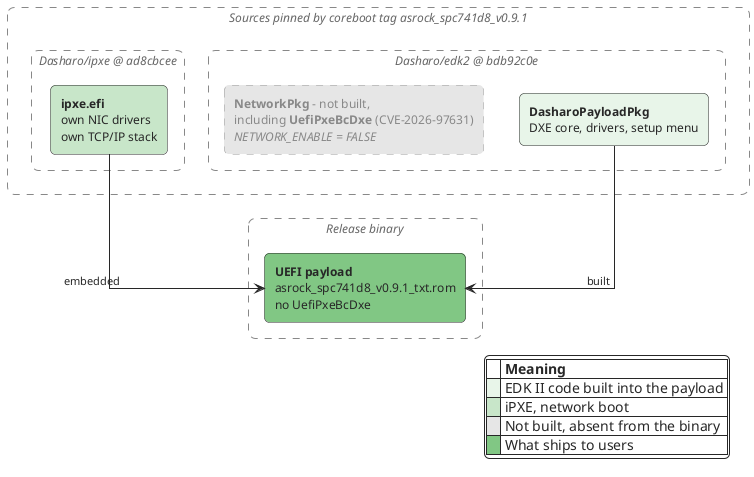

## Introduction

On 22nd October 2026 TianoCore published security advisory
[GHSA-99cj-7hg9-mp4m][ghsa] ([CVE-2026-97631][cve], CVSS 4.0 score 9.5). It
describes a pre-boot remote code execution vulnerability in the EDK II PXE Base
Code driver, [`NetworkPkg/UefiPxeBcDxe`][edk2-pxe-dir]. Since EDK II is the
reference implementation that most UEFI firmware is built on, the advisory
quickly reached the news.

Many of you asked us whether Dasharo is affected. Thank you for asking: your
attention to the security of the firmware you run is what makes Dasharo
better, and we value it.

Our answer: **current Dasharo releases are not affected**, because they do not
include the EDK II network stack at all. By current releases we mean the
latest Dasharo (coreboot+UEFI) release of each platform listed on
[docs.dasharo.com][dasharo-docs]. You do not have to take our word for it.
Below we explain why and show how to confirm it yourself.

We verified this against the releases listed on 2nd November 2026. On that
date CVE-2026-97631 was not listed in the
[CISA Known Exploited Vulnerabilities catalog][cisa-kev] (catalog version
2026.10.30).

## The vulnerability

The ICMP error handlers in the PXE driver,
[`PxeBcIcmpErrorDpcHandle`][edk2-icmp4] and
[`PxeBcIcmp6ErrorDpcHandle`][edk2-icmp6], copy ICMP error messages into a
fixed-size buffer without bounding the copy correctly. According to the
[advisory][ghsa], an attacker who can send a crafted ICMP error message to a
machine while it is PXE-booting can corrupt the driver's data. With knowledge
of the firmware build, the attacker can also execute code in DXE, before any
operating system security control exists.

The precondition is important: the vulnerable code runs only when the
firmware's own EDK II PXE driver is present and in use.

## Why current Dasharo releases are not affected

We use the [ASRock SPC741D8 Dasharo v0.9.1 release][spc-release] as the
example, a server platform. It is built from coreboot tag
[`asrock_spc741d8_v0.9.1`][cb-tag].

<div style="margin: 4em 1em 2em 1em">
  
  <figcaption style="text-align: center;">
    What goes into the ASRock SPC741D8 v0.9.1 UEFI payload
  </figcaption>
</div>

<!--

Diagram source:



-->

### The EDK II network stack is not built

1. coreboot builds the [`DasharoPayloadPkg`][cb-payload-name] UEFI payload
   from [Dasharo/edk2 `bdb92c0e`][cb-edk2-rev].
2. That payload sets [`NETWORK_ENABLE = FALSE`][edk2-net-enable].
3. Every NetworkPkg driver depends on that switch. The payload includes the
   NetworkPkg lists in both the [build description][edk2-dsc-include] and the
   [flash image description][edk2-fdf-include]. Both lists are wrapped in
   `!if $(NETWORK_ENABLE) == TRUE` ([build][edk2-components-gate],
   [flash image][edk2-fdf-gate]). That covers SNP, MNP, IP4/6, UDP, DHCP, TCP
   and the vulnerable [`UefiPxeBcDxe`][edk2-fdf-pxe].
4. The board configuration does not turn it back on. The only way to pass
   extra flags to the EDK II build is
   [`CONFIG_EDK2_CUSTOM_BUILD_PARAMS`][cb-custom-params]. For this board it
   [sets only two TCG event log sizes][cb-config-params].

### Network boot comes from iPXE

The board configuration enables iPXE with
[`CONFIG_EDK2_ENABLE_IPXE=y`][cb-config-ipxe]. coreboot builds it from
[Dasharo/ipxe `ad8cbcee`][cb-ipxe-rev] and the payload embeds it as a single
file, [`ipxe.efi`][edk2-fdf-ipxe], GUID
[`B68653C7-EEA1-4435-A199-A44F59E4476C`][edk2-ipxe-guid].

iPXE implements its own [IPv4][ipxe-ipv4], [IPv6][ipxe-ipv6],
[ICMPv4][ipxe-icmpv4], [ICMPv6][ipxe-icmpv6], [UDP][ipxe-udp] and
[TCP][ipxe-tcp]. It does not contain any EDK II network code.

## Releases from 2022

Some Dasharo releases published in 2022 did build the EDK II network stack,
`UefiPxeBcDxe` included, and its code in those releases is the vulnerable
one. We found no way to reach it in normal use: the driver runs only during
a UEFI PXE boot, and those releases lack the driver that connects the EDK II
network stack to the network controller, so no UEFI PXE boot option is
created. We have not tested an add-in network card whose own firmware
provides that connection. Those releases are around four years old, so treat
them as affected and update to a current release. [DSB-003][dsb-003] lists
the affected releases and the first fixed release for each platform. The
GUID check below works on any release, so you can also test the one you run.

## Check it yourself

The test that decides is the driver's file GUID. `UefiPxeBcDxe` has declared
the same GUID in its [source][edk2-pxe-guid] since it was added to edk2 in
[2010][edk2-pxe-add], so it does not depend on the edk2 revision. To show
that the test works and that the release was not built some other way, we
compare the release with builds made from the same source:

1. the release payload is exactly what its coreboot tag builds
2. the same build with the EDK II network stack switched on contains
   `UefiPxeBcDxe` under that GUID
3. the release payload contains no file with that GUID

You need `git`, Docker, the release binary and the [Dasharo SDK container][sdk].
The container ships [`cbfstool`][sdk-cbfstool] and
[`uefiextract`][sdk-uefiextract] from [UEFITool][uefitool]. To keep the
commands short, define an alias that runs a tool from the SDK on the current
directory:

```bash
alias dasharo-sdk='docker run --rm -u "$(id -u):$(id -g)" -v "$PWD":/work -w /work ghcr.io/dasharo/dasharo-sdk:v1.9.5'
```

### Step 1: take the payload from the release

The example uses the ASRock SPC741D8 v0.9.1 release binary
`asrock_spc741d8_v0.9.1_txt.rom`. Check that its SHA-256 hash matches the one
published for the [release][spc-release], then extract the UEFI payload as it is
stored in the image:

```bash
$ sha256sum asrock_spc741d8_v0.9.1_txt.rom
543dfddf14af10b4752744d069f9f65a65ee7bbb74efcb17c5994f18af5623e6  asrock_spc741d8_v0.9.1_txt.rom
$ dasharo-sdk cbfstool asrock_spc741d8_v0.9.1_txt.rom extract -r COREBOOT -n fallback/payload -U -f release.payload
$ sha256sum release.payload
b6037bff879b2a85aa1b3233489f5fd73dd9bd8757fba4baa15e0ff934de9b00  release.payload
```

### Step 2: rebuild the payload from the release tag

Build the release tag with the [build script][cb-build-asrock] it ships:

```bash
git clone https://github.com/Dasharo/coreboot.git
cd coreboot
git checkout asrock_spc741d8_v0.9.1
./build.sh asrock_spc741d8
cd ..
```

```bash
$ dasharo-sdk cbfstool coreboot/asrock_spc741d8_v0.9.1.rom extract -r COREBOOT -n fallback/payload -U -f rebuilt.payload
$ sha256sum rebuilt.payload
b6037bff879b2a85aa1b3233489f5fd73dd9bd8757fba4baa15e0ff934de9b00  rebuilt.payload
```

The hashes match. The UEFI payload in the release is exactly what this source
produces. The rest of the image differs, because the release also contains
Intel TXT modules and is signed for Boot Guard, but neither is part of the
payload.

### Step 3: build the vulnerable driver on purpose

Now switch the EDK II network stack on, build again and keep the result as a
reference:

```bash
cd coreboot
sed -i 's/^\(CONFIG_EDK2_CUSTOM_BUILD_PARAMS=".*\)"$/\1 -D NETWORK_ENABLE=TRUE"/' configs/config.asrock_spc741d8
./build.sh asrock_spc741d8
mv asrock_spc741d8_v0.9.1.rom ../control.rom
git checkout configs/config.asrock_spc741d8
cd ..
```

List the files in its payload and find the driver:

```bash
$ dasharo-sdk cbfstool control.rom extract -r COREBOOT -n fallback/payload -m x86 -f control.elf
$ dasharo-sdk uefiextract control.elf all
$ dasharo-sdk uefiextract control.elf report
$ grep B95E9FDA control.elf.report.txt
 File            | DXE driver            | 004AC9E8 | 0001187A | D2DF8ACD | -- B95E9FDA-26DE-48D2-8807-1F9107AC5E3A | UefiPxeBcDxe
```

> `uefiextract` warns that it found no volume top file. That is expected: the
> payload is not a complete flash image.
>
> ```text
> parse: not a single Volume Top File is found, the image may be corrupted
> ```

The file GUID is the one declared in the driver's [source][edk2-pxe-guid]. The
same search finds the driver whenever it is built in.

### Step 4: look for it in the release

```bash
dasharo-sdk cbfstool asrock_spc741d8_v0.9.1_txt.rom extract -r COREBOOT -n fallback/payload -m x86 -f release.elf
dasharo-sdk uefiextract release.elf all
dasharo-sdk uefiextract release.elf report
grep B95E9FDA release.elf.report.txt
```

The search prints nothing. The release payload contains no file with the
driver's GUID.

Finally, compare the lists of files in both payloads. `comm -23` prints files
only in the release, `comm -13` files only in the reference build:

```bash
$ sed -n 's/^ *File .*-- //p' release.elf.report.txt | sort > release.files
$ sed -n 's/^ *File .*-- //p' control.elf.report.txt | sort > control.files
$ comm -23 release.files control.files
$ comm -13 release.files control.files
025BBFC7-E6A9-4B8B-82AD-6815A1AEAF4A | MnpDxe
1A7E4468-2F55-4A56-903C-01265EB7622B | TcpDxe
22EA234F-E72A-11E4-91F9-28D2447C4829 | HttpUtilitiesDxe
2366C20F-E15A-11E3-8BF1-E4115B28BC50 | HttpDxe
529D3F93-E8E9-4E73-B1E1-BDF6A9D50113 | ArpDxe
6D6963AB-906D-4A65-A7CA-BD40E5D6AF2B | Udp4Dxe
86CDDF93-4872-4597-8AF9-A35AE4D3725F | IScsiDxe
94734718-0BBC-47FB-96A5-EE7A5AE6A2AD | Dhcp4Dxe
9FB1A1F3-3B71-4324-B39A-745CBB015FFF | Ip4Dxe
A210F973-229D-4F4D-AA37-9895E6C9EABA | DpcDxe
B219E140-DFFC-11E3-B956-0022681E6906 | DnsDxe
B95E9FDA-26DE-48D2-8807-1F9107AC5E3A | UefiPxeBcDxe
DC3641B8-2FA8-4ED3-BC1F-F9962A03454B | Mtftp4Dxe
E4F61863-FE2C-4B56-A8F4-08519BC439DF | VlanConfigDxe
ECEBCB00-D9C8-11E4-AF3D-8CDCD426C973 | HttpBootDxe
```

The release has 124 files and the reference build 139. Switching the network
stack on adds exactly these 15 NetworkPkg drivers, `UefiPxeBcDxe` among them,
and none of them is in the release. The first command prints nothing: no file
is listed only in the release.

### Optional: compare the driver's code

The reference build also lets you hash the driver's code:

```bash
$ sha256sum control.elf.dump/*/*UefiPxeBcDxe/*PE32*/body.bin
39652754025079b4c37aca0b91c855d69a814b67f20291cd6b0e4ccd204033e7  control.elf.dump/2 8C8CE578-8A3D-4F1C-9935-896185C32DD3/93 UefiPxeBcDxe/1 PE32 image section/body.bin
$ find release.elf.dump -name body.bin -exec sha256sum {} + | grep 39652754025079b4
```

The second command prints nothing which means that no file in the release has
this code, under any name or GUID. This hash identifies the driver only as
built from this revision of edk2 with this toolchain. Any other edk2 revision,
and so any other Dasharo release may produce a different hash. A missing hash
proves nothing about another release, so use the GUID check above to test the
release you run.

### Do not grep for strings

You may be tempted to search the payload for the driver's
[display name][edk2-pxe-name]:

```bash
strings -el payload.elf | grep "UEFI PXE Base Code Driver"
```

This does find a match, but not the EDK II driver: the string is part of
iPXE. At startup, iPXE unloads a few known-problematic firmware drivers, and
[one entry in that list][ipxe-veto] matches VMware's build of the PXE Base
Code driver by name. Check by GUID, as shown above.

## Summary

CVE-2026-97631 is a serious vulnerability, but it lives in a component that
current Dasharo releases do not build. Network boot in Dasharo goes through
iPXE, which has its own network stack. More importantly, this is something
you can verify yourself, on the binary you run. That is what open-source
firmware should make possible.

Unlock the full potential of your hardware and secure your firmware with the
experts at 3mdeb! If you're looking to boost your product's performance and
protect it from potential security threats, our team is here to help.
[Schedule a call with
us](https://cloud.3mdeb.com/index.php/apps/calendar/appointment/n7T65toSaD9t)
or drop us an email at `contact<at>3mdeb<dot>com` to start unlocking the
hidden benefits of your hardware. And if you want to stay up-to-date on all
things firmware security and optimization, be sure to sign up for our
newsletter:



[ghsa]: https://github.com/tianocore/edk2/security/advisories/GHSA-99cj-7hg9-mp4m
[cve]: https://www.cve.org/CVERecord?id=CVE-2026-97631
[dsb-003]: https://github.com/3mdeb/3mdeb-secpack/blob/master/DSBs/dsb-003-2026.txt
[cisa-kev]: https://www.cisa.gov/known-exploited-vulnerabilities-catalog
[dasharo-docs]: https://docs.dasharo.com/
[spc-release]: https://docs.dasharo.com/variants/asrock_spc741d8/releases/#v091-2026-10-15
[cb-tag]: https://github.com/Dasharo/coreboot/tree/1de5aa934d11eae58935184a9a066fdade2bb1c0
[cb-build-asrock]: https://github.com/Dasharo/coreboot/blob/1de5aa934d11eae58935184a9a066fdade2bb1c0/build.sh#L337-L352
[cb-payload-name]: https://github.com/Dasharo/coreboot/blob/1de5aa934d11eae58935184a9a066fdade2bb1c0/payloads/external/edk2/Makefile#L30
[cb-edk2-rev]: https://github.com/Dasharo/coreboot/blob/1de5aa934d11eae58935184a9a066fdade2bb1c0/payloads/external/edk2/Kconfig.dasharo#L7
[cb-custom-params]: https://github.com/Dasharo/coreboot/blob/1de5aa934d11eae58935184a9a066fdade2bb1c0/payloads/external/edk2/Makefile#L511-L512
[cb-config-params]: https://github.com/Dasharo/coreboot/blob/1de5aa934d11eae58935184a9a066fdade2bb1c0/configs/config.asrock_spc741d8#L87
[cb-config-ipxe]: https://github.com/Dasharo/coreboot/blob/1de5aa934d11eae58935184a9a066fdade2bb1c0/configs/config.asrock_spc741d8#L61
[cb-ipxe-rev]: https://github.com/Dasharo/coreboot/blob/1de5aa934d11eae58935184a9a066fdade2bb1c0/payloads/external/iPXE/Makefile#L7-L14
[edk2-net-enable]: https://github.com/Dasharo/edk2/blob/bdb92c0e8f8fde2b25c350cdd1c4da5ff3e91749/DasharoPayloadPkg/DasharoPayloadPkg.dsc#L135
[edk2-dsc-include]: https://github.com/Dasharo/edk2/blob/bdb92c0e8f8fde2b25c350cdd1c4da5ff3e91749/DasharoPayloadPkg/DasharoPayloadPkg.dsc#L1080-L1082
[edk2-fdf-include]: https://github.com/Dasharo/edk2/blob/bdb92c0e8f8fde2b25c350cdd1c4da5ff3e91749/DasharoPayloadPkg/DasharoPayloadPkg.fdf#L331
[edk2-components-gate]: https://github.com/Dasharo/edk2/blob/bdb92c0e8f8fde2b25c350cdd1c4da5ff3e91749/NetworkPkg/NetworkComponents.dsc.inc#L15-L67
[edk2-fdf-gate]: https://github.com/Dasharo/edk2/blob/bdb92c0e8f8fde2b25c350cdd1c4da5ff3e91749/NetworkPkg/Network.fdf.inc#L13-L66
[edk2-fdf-pxe]: https://github.com/Dasharo/edk2/blob/bdb92c0e8f8fde2b25c350cdd1c4da5ff3e91749/NetworkPkg/Network.fdf.inc#L44
[edk2-fdf-ipxe]: https://github.com/Dasharo/edk2/blob/bdb92c0e8f8fde2b25c350cdd1c4da5ff3e91749/DasharoPayloadPkg/DasharoPayloadPkg.fdf#L351-L358
[edk2-ipxe-guid]: https://github.com/Dasharo/edk2/blob/bdb92c0e8f8fde2b25c350cdd1c4da5ff3e91749/DasharoPayloadPkg/DasharoPayloadPkg.fdf#L355
[edk2-pxe-dir]: https://github.com/Dasharo/edk2/tree/bdb92c0e8f8fde2b25c350cdd1c4da5ff3e91749/NetworkPkg/UefiPxeBcDxe
[edk2-pxe-guid]: https://github.com/Dasharo/edk2/blob/bdb92c0e8f8fde2b25c350cdd1c4da5ff3e91749/NetworkPkg/UefiPxeBcDxe/UefiPxeBcDxe.inf#L16-L17
[edk2-pxe-add]: https://github.com/tianocore/edk2/blob/a3bcde70e6dc69000f85cc5deee98101d2ae200a/NetworkPkg/UefiPxeBcDxe/UefiPxeBcDxe.inf#L19
[edk2-pxe-name]: https://github.com/Dasharo/edk2/blob/bdb92c0e8f8fde2b25c350cdd1c4da5ff3e91749/NetworkPkg/UefiPxeBcDxe/ComponentName.c#L158
[edk2-icmp4]: https://github.com/Dasharo/edk2/blob/bdb92c0e8f8fde2b25c350cdd1c4da5ff3e91749/NetworkPkg/UefiPxeBcDxe/PxeBcSupport.c#L242
[edk2-icmp6]: https://github.com/Dasharo/edk2/blob/bdb92c0e8f8fde2b25c350cdd1c4da5ff3e91749/NetworkPkg/UefiPxeBcDxe/PxeBcSupport.c#L377
[ipxe-ipv4]: https://github.com/Dasharo/ipxe/blob/ad8cbcee950840547f87394179a7e712e1c3c06f/src/net/ipv4.c
[ipxe-ipv6]: https://github.com/Dasharo/ipxe/blob/ad8cbcee950840547f87394179a7e712e1c3c06f/src/net/ipv6.c
[ipxe-icmpv4]: https://github.com/Dasharo/ipxe/blob/ad8cbcee950840547f87394179a7e712e1c3c06f/src/net/icmpv4.c
[ipxe-icmpv6]: https://github.com/Dasharo/ipxe/blob/ad8cbcee950840547f87394179a7e712e1c3c06f/src/net/icmpv6.c
[ipxe-udp]: https://github.com/Dasharo/ipxe/blob/ad8cbcee950840547f87394179a7e712e1c3c06f/src/net/udp.c
[ipxe-tcp]: https://github.com/Dasharo/ipxe/blob/ad8cbcee950840547f87394179a7e712e1c3c06f/src/net/tcp.c
[ipxe-veto]: https://github.com/Dasharo/ipxe/blob/ad8cbcee950840547f87394179a7e712e1c3c06f/src/interface/efi/efi_veto.c#L450-L475
[sdk]: https://github.com/Dasharo/dasharo-sdk/tree/df1ddce5daf147b631220036f6c3807037bb1c6d
[sdk-cbfstool]: https://github.com/Dasharo/dasharo-sdk/blob/df1ddce5daf147b631220036f6c3807037bb1c6d/Dockerfile#L86
[sdk-uefiextract]: https://github.com/Dasharo/dasharo-sdk/blob/df1ddce5daf147b631220036f6c3807037bb1c6d/Dockerfile#L46-L49
[uefitool]: https://github.com/LongSoft/UEFITool
